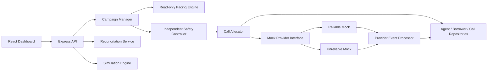

# SmartDialer: Safe Progressive and Predictive Dialing Simulator

SmartDialer is a locally runnable full-stack prototype for a collections-campaign dialer. It demonstrates how progressive and explainable rule-based predictive pacing can improve agent utilization while an independent Safety Controller remains responsible for every call-initiation decision.

**This is a simulator, not a production dialer.** It uses synthetic borrower records and two mock telecom providers. It does not contact real borrowers, place real calls, or require a telecom account or credentials.

## Project Overview

The project is a modular monolith with a TypeScript/Express backend, in-memory and optional Mongoose repositories, deterministic simulation and tests, and a React/Vite operations dashboard.

| Component | Purpose |
|---|---|
| Campaign Manager | Owns campaign lifecycle, mode selection, and one dial cycle. |
| Pacing Engine | Produces a read-only estimate from answer history, in-flight calls, talk duration, setup latency, and provider health. |
| Safety Controller | Independently caps approvals, reserves a short-lived initiation budget, and checks campaign/global capacity, agent capacity, pause/stop, and circuit state. |
| Call Allocator | Reserves an agent and borrower, records call state, consumes the Safety Controller authorization, and invokes a mock provider. |
| Mock providers | Simulate reliable or unreliable initiation, delayed lifecycle events, failures, duplicate/out-of-order notifications, and outages. |
| Provider Event Processor | Applies call events using state-machine rules and version compare-and-set; records duplicate, stale, and invalid outcomes. |
| Reconciliation Service | Reclaims expired reservations and cancels stale or orphaned calls. It runs periodically in the API process and can also be triggered from the dashboard. |
| Simulation Engine | Runs fixed-seed scenarios A–D and records timeline and invariant metrics. |
| Dashboard | Displays live agent/call counts, provider health, pacing, safety decisions, cycle outcomes, simulations, and failure scenarios. |

## Requirements Demonstrated

- Progressive mode allocates no more agent-bound calls than currently available, safely reservable agents.
- Predictive mode can recommend a batch, but the Safety Controller independently limits it. The current allocator still requires one available agent per agent-bound call.
- An agent or borrower reservation uses an atomic state/version check. In-memory locking guarantees apply to workers in one Node process; Mongo uses conditional updates per record.
- Calls follow explicit lifecycle states and mock-provider events. A dial cycle may return while calls are still initiated, ringing, answered, or connected.
- Provider termination is represented as `CANCELLED`; `COMPLETED` is emitted only after the configured simulated talk duration.
- Duplicate and stale events are audited. Call and resource updates use compare-and-set to reduce concurrent overwrites.
- Failure tests cover races, provider outage, dropped agents, stale reservations/calls, duplicate events, and out-of-order events.

## Prerequisites

- Windows, macOS, or Linux
- Node.js 20 or newer and npm
- MongoDB is optional. The default in-memory configuration does not require Docker or MongoDB.

## Run on Windows

Open PowerShell in the cloned project directory. Install the backend and frontend dependencies:

```powershell
npm install --prefix backend
npm install --prefix frontend
```

Optionally create a local backend environment file. The defaults work without this file:

```powershell
Copy-Item .env.example backend/.env
```

Start the backend in the first terminal:

```powershell
npm run dev:backend
```

Start the frontend in a second terminal:

```powershell
npm run dev:frontend
```

Open http://localhost:3000. The API health check is http://localhost:4000/api/health. Vite proxies `/api` requests to the backend.

The in-memory server creates a stopped demonstration campaign with 25 synthetic agents and 100 synthetic borrowers at startup. In the dashboard, select a campaign, press **Start Campaign**, then **Trigger Dial Cycle**. Calls are initiated through the mock provider; after the cycle returns, inspect the live call cards and allocation breakdown for intermediate states. The default simulated talk interval is 15 seconds after connection.

## Configuration

Copy `.env.example` to `backend/.env` to override settings. The template includes:

| Variable | Default | Description |
|---|---:|---|
| `PORT` | `4000` | Express API port. |
| `STORAGE_MODE` | `in-memory` | Use in-memory repositories or optional `mongodb`. |
| `MONGODB_URI` | local Mongo URI | MongoDB connection string when Mongo mode is enabled. |
| `GLOBAL_MAX_CONCURRENT_CALLS` | `100` | Intended global prototype cap. The Safety Controller currently uses a code-level default of 100. |
| `ORPHAN_RECONCILIATION_INTERVAL_SECONDS` | `10` | Periodic stale-work sweep interval. |
| `DEMO_AGENT_COUNT` | `25` | Startup synthetic agent count; does not increase safety caps. |
| `DEMO_BORROWER_COUNT` | `100` | Startup synthetic borrower count. |
| `MOCK_RINGING_DELAY_MS` | `100` | Mock RINGING delay (unreliable provider uses its own default if unset). |
| `MOCK_ANSWERED_DELAY_MS` | `500` | Mock ANSWERED delay. |
| `MOCK_CONNECTED_DELAY_MS` | `750` | Mock CONNECTED delay. |
| `MOCK_TALK_DURATION_MS` | `15000` | Time from connection until normal mock completion. |

The mock provider health, outage, failure rate, and the `maxConcurrentCalls` campaign setting do not grant permission to exceed Safety Controller limits.

## Normal Dashboard Workflow

1. Select the campaign in the campaign picker or create a new campaign.
2. Select **Progressive** or **Predictive** mode in the header.
3. Optionally add synthetic demo records with the seed button. Its default is 25 agents and 100 borrowers; the API accepts validated custom counts.
4. Start the campaign.
5. Trigger a single dial cycle. It is not a continuous dialing loop.
6. Review the latest cycle breakdown: total/eligible agents, queued borrowers, pacing recommendation, safety-approved count, provider health, initiated count, completions that occurred during that cycle, and borrowers still queued.
7. Watch the live call/agent counts and event audit update as delayed mock events arrive.
8. Use the simulation and failure-scenario panels to exercise seeded conditions without real calls.

## Optional MongoDB

MongoDB is not required for the local demo or tests. To start the optional local Mongo service:

```powershell
docker compose up -d mongodb
```

Set `STORAGE_MODE=mongodb` in `backend/.env`, then restart the backend. The Mongo repositories use conditional state/version updates for individual agent, borrower, and call records. The entire workflow across agent reservation, borrower reservation, call creation, event audit, and provider initiation is **not** one transaction. Campaign definitions, safety grants, breaker state, and event deduplication are process-local. Multi-instance/global-cap safety has not been verified.

## Commands

Run from the repository root:

```powershell
npm run build
npm test
npm run load-test
npm run seed
```

`npm run build` type-checks and builds the backend and frontend. `npm test` runs the Vitest suites. `npm run load-test` runs the local mock-provider load script. `npm run seed` requires the API to be running; it creates a **new stopped** sandbox campaign with 25 agents and 100 borrowers, so it does not overwrite the currently selected campaign. Set `SMARTDIALER_API_URL` if the API is not at `http://localhost:4000/api`.

Tests are in `backend/tests/` and use in-memory repositories by default. They do not prove Mongo replica-set concurrency or multiple-process coordination.

## API Reference

Useful endpoints include:

| Method and route | Purpose |
|---|---|
| `GET /api/health` | API health check. |
| `GET /api/campaigns` | List campaigns. |
| `POST /api/campaigns` | Create a campaign. |
| `GET /api/campaigns/:id/agents` | Agent list and state counts. |
| `GET /api/campaigns/:id/borrowers` | Borrower list and state counts. |
| `GET /api/campaigns/:id/calls` | Call list, call state counts, and queued borrower count. |
| `GET /api/campaigns/:id/metrics` | Campaign/provider/safety metrics. |
| `GET /api/campaigns/:id/recommendation` | Read-only pacing estimate. |
| `POST /api/campaigns/:id/start` | Start a campaign. |
| `POST /api/campaigns/:id/pause` | Pause a campaign. |
| `POST /api/campaigns/:id/stop` | Stop a campaign. |
| `POST /api/campaigns/:id/dial` | Run one dial cycle and return allocation breakdown. |
| `POST /api/campaigns/:id/reconcile` | Manually reconcile stale reservations and calls. |
| `POST /api/campaigns/:id/seed` | Add synthetic agents and borrowers. |
| `GET /api/providers/health` | Active mock provider health. |
| `POST /api/providers/switch` | Switch mock providers. |
| `POST /api/providers/outage` | Inject or clear a mock outage. |
| `GET /api/safety/decisions` | Safety decision audit; authorization tokens are not exposed. |
| `POST /api/simulation/run` | Run a seeded scenario. |
| `POST /api/simulation/failure-scenario` | Run a mock failure scenario. |

## Architecture and State Machines



The Pacing Engine has no provider initiation method or allocator reference. It proposes a call count only. The Safety Controller reserves a short-lived, consumable authorization; the allocator validates it immediately before the provider call.

Agent states: `OFFLINE`, `AVAILABLE`, `RESERVED`, `DIALING`, `CONNECTED`, `WRAP_UP`, `PAUSED`.

Call states: `QUEUED`, `RESERVED`, `INITIATED`, `RINGING`, `ANSWERED`, `CONNECTED`, `COMPLETED`, `FAILED`, `CANCELLED`. `COMPLETED`, `FAILED`, and `CANCELLED` are terminal.

See [ADR-001](docs/ADR-001.md), [simulation results](docs/SIMULATION_RESULTS.md), [load-test results](docs/LOAD_TEST_RESULTS.md), [dataset profile](docs/DATASET_PROFILE.md), and [final assignment response](docs/FINAL_ANSWER.md) for design choices, measurements, dataset mapping, and known scale trade-offs.

## Synthetic Dataset

`collections_30k_dataset/` contains the supporting analyst-challenge CSVs and data dictionary. They are intentionally duplicated and inconsistent. There is no live CSV importer. Demo startup and UI seed actions create clean synthetic records independently. Read [DATASET_PROFILE.md](docs/DATASET_PROFILE.md) before considering any future import; original CSVs should remain unchanged and historical events must not mutate live agent/call states.

## Troubleshooting

- **Dashboard says it cannot connect:** confirm the backend is running on port 4000 and `http://localhost:4000/api/health` responds.
- **Port is already in use:** stop the old dev process or change `PORT` for the backend and the Vite proxy target in `frontend/vite.config.ts`.
- **No calls initiate:** confirm the campaign is ACTIVE, agents are AVAILABLE, borrowers are QUEUED, the provider is healthy, and the circuit is not OPEN. Check the Safety Controller audit and latest cycle breakdown for the reason.
- **Calls remain ringing/connected:** this is expected until the configured mock delays elapse. Set lower `MOCK_*_DELAY_MS` values in `backend/.env` for faster local inspection, then restart the backend.
- **MongoDB connection error:** omit `STORAGE_MODE=mongodb` for the default in-memory run, or start the optional service with `docker compose up -d mongodb`.
- **Build reports a large frontend chunk:** Vite emits a size advisory for the charting/icon bundle; it does not fail the build.

## Upload to GitHub

Create an empty repository on GitHub. From the project root, inspect what will be published before staging:

```powershell
git status --short
git check-ignore backend/.env backend/node_modules frontend/node_modules
```

Stage the source, tests, and submission documents explicitly (avoid blindly staging local files):

```powershell
git add .gitignore .env.example README.md package.json tsconfig.base.json docker-compose.yml backend frontend docs packages
git status --short
git diff --cached --stat
```

The original dataset is synthetic but optional for running the dialer. Include it only if you intend to publish those CSVs and have checked repository size and challenge redistribution terms:

```powershell
git add collections_30k_dataset
```

Review staged changes for `.env`, credentials, generated `dist/`, `node_modules/`, and other local data. Then commit and push. If this repository has no remote yet, substitute your GitHub URL:

```powershell
git branch --show-current
git remote -v
git remote add origin <github-remote-url>
git commit -m "Document and verify SmartDialer simulator"
git push -u origin <branch-name>
```

If `origin` already exists, do not add it again; confirm it points to your GitHub repository and push the current branch. Never commit `backend/.env` or any real borrower/contact data.

## Known Limitations

- In-memory reservations, safety authorization budgets, breaker state, and idempotency state protect one backend process only.
- MongoDB uses per-record conditional updates, but multi-document allocation is not transactional; Mongo replica-set and multi-process behavior are not verified.
- No real telephony, borrower contact, authentication, authorization, PII handling, or production secrets are involved.
- The dashboard refreshes by polling. The rule-based pacing prior is a prototype assumption, not an ML or statistically validated prediction.
- Load-test numbers are local prototype results, not capacity guarantees. The current p95 sample is a rough diagnostic and mixes timing scopes.
- Vite reports a frontend chunk-size advisory; production code splitting has not been optimized.

